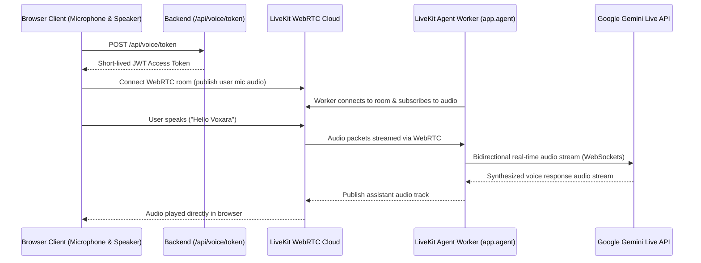

# Voxara AI Backend

Python backend infrastructure for Voxara AI, providing secure LiveKit token issuance, session configuration, and the entrypoint for the LiveKit Voice Agent worker powered by Google's Gemini Live API.

---

## Directory Structure

```
backend/
├── app/
│   ├── routes/
│   │   ├── __init__.py
│   │   └── voice.py         # /api/voice/status and /api/voice/token endpoints
│   ├── services/
│   │   ├── __init__.py
│   │   └── token_service.py # LiveKit JWT AccessToken generator with strict permissions
│   ├── __init__.py
│   ├── agent.py             # LiveKit Voice Agent worker entrypoint with Gemini Live
│   ├── config.py            # Pydantic Settings & environment variable validation
│   └── main.py              # FastAPI app setup, CORS, lifespan, and /health
├── .env.example             # Template for required environment variables
├── requirements.txt         # FastAPI, LiveKit SDK, Agent & Google plugin dependencies
└── venv/                    # Python virtual environment
```

---

## Prerequisites

- Python 3.10+ (tested with Python 3.12)
- A LiveKit Cloud account ([https://cloud.livekit.io](https://cloud.livekit.io))
- A Google Gemini API Key ([https://aistudio.google.com/apikey](https://aistudio.google.com/apikey))

---

## Setup & Running

### 1. Configure Environment Variables

Copy the example file to `.env`:

```bash
cp .env.example .env
```

Open `.env` and fill in your LiveKit and Gemini credentials:
```ini
LIVEKIT_URL=wss://your-project.livekit.cloud
LIVEKIT_API_KEY=your_api_key
LIVEKIT_API_SECRET=your_api_secret
LIVEKIT_DEFAULT_ROOM=voxara-voice-room

# Google Gemini API key
GOOGLE_API_KEY=your_google_gemini_api_key
GEMINI_MODEL=gemini-2.5-flash-native-audio-preview-12-2025
GEMINI_VOICE=Puck

HOST=0.0.0.0
PORT=8000
CORS_ORIGINS=http://localhost:5173,http://127.0.0.1:5173
```

> **Security Note:** Never commit `.env` or expose `LIVEKIT_API_SECRET` or `GOOGLE_API_KEY` to the client.

### 2. Activate Virtual Environment & Install Dependencies

```bash
# Windows
.\venv\Scripts\activate
pip install -r requirements.txt

# macOS/Linux
source venv/bin/activate
pip install -r requirements.txt
```

### 3. Start the FastAPI API Server

```bash
uvicorn app.main:app --host 0.0.0.0 --port 8000 --reload
```

The server will start at `http://localhost:8000`. You can test health at:
- `GET http://localhost:8000/health`
- `GET http://localhost:8000/api/voice/status`

### 4. Run the LiveKit Voice Agent Worker (Gemini Live)

In a separate terminal with the virtual environment activated, run:

```bash
# Windows
.\venv\Scripts\activate
python -m app.agent dev

# macOS/Linux
source venv/bin/activate
python -m app.agent dev
```

---

## Voice Interaction Flow



---

## Current Status (Step 3: Gemini Live Integration)

- **Implemented**: Full Gemini Live multimodal real-time voice pipeline using `livekit-plugins-google==1.8.6`, `RealtimeModel` with native audio streaming, `AgentSession` event handling, system instructions, and state indicators.
- **Next Phase (Step 4/5)**: LangGraph agentic workflow execution and MCP tool execution engine.
