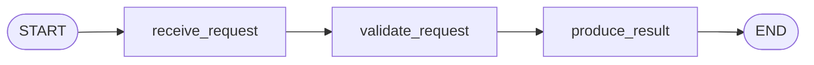
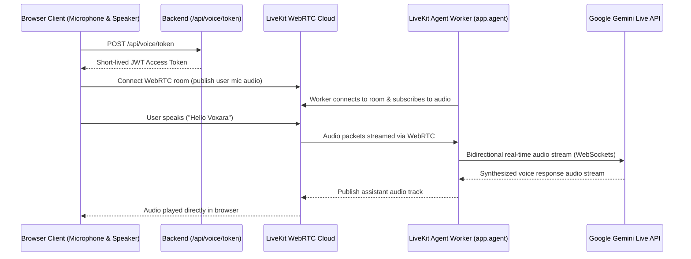
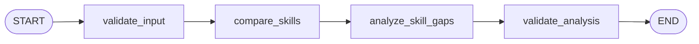

# Voxara AI Backend

Python backend infrastructure for Voxara AI, providing secure LiveKit token issuance, session configuration, and the entrypoint for the LiveKit Voice Agent worker powered by Google's Gemini Live API.

---

## Directory Structure

backend/
├── app/
│   ├── routes/
│   │   ├── __init__.py
│   │   ├── voice.py         # /api/voice/status and /api/voice/token endpoints
│   │   └── workflows.py     # /api/workflows/status, /demo, and /skill-analysis endpoints
│   ├── services/
│   │   ├── __init__.py
│   │   ├── token_service.py # LiveKit JWT AccessToken generator with strict permissions
│   │   └── gemini_service.py# Isolated Gemini text generation & skill gap analysis
│   ├── workflows/
│   │   ├── __init__.py
│   │   ├── state.py         # State schemas, events & Pydantic models (Step 4A & 4B)
│   │   ├── nodes.py         # Step 4A demo workflow nodes
│   │   ├── graph.py         # Step 4A demo workflow graph definition
│   │   ├── skill_nodes.py   # Step 4B validate_input, compare_skills, analyze_skill_gaps, validate_analysis
│   │   └── skill_graph.py   # Step 4B Skill Analysis StateGraph and async runner
│   ├── __init__.py
│   ├── agent.py             # LiveKit Voice Agent worker entrypoint with Gemini Live
│   ├── config.py            # Pydantic Settings & environment variable validation
│   └── main.py              # FastAPI app setup, CORS, lifespan, and /health
├── tests/
│   ├── __init__.py
│   ├── test_workflows.py    # Pytest suite for Step 4A demo workflow & endpoints
│   └── test_skill_analysis.py # Pytest suite for Step 4B skill analysis workflow
├── .env.example             # Template for required environment variables
├── requirements.txt         # FastAPI, LiveKit SDK, google-genai, LangGraph & Pytest
└── venv/                    # Python virtual environment
```

---

## Prerequisites

- Python 3.10+ (tested with Python 3.12)
- A LiveKit Cloud account ([https://cloud.livekit.io](https://cloud.livekit.io))
- A Google Gemini API Key ([https://aistudio.google.com/apikey](https://aistudio.google.com/apikey))

---

## Setup & Running

### 1. Configure Environment Variables

Copy the example file to `.env`:

```bash
cp .env.example .env
```

Open `.env` and fill in your LiveKit and Gemini credentials:
```ini
LIVEKIT_URL=wss://your-project.livekit.cloud
LIVEKIT_API_KEY=your_api_key
LIVEKIT_API_SECRET=your_api_secret
LIVEKIT_DEFAULT_ROOM=voxara-voice-room

# Google Gemini API key
GOOGLE_API_KEY=your_google_gemini_api_key
GEMINI_MODEL=gemini-2.5-flash-native-audio-preview-12-2025
GEMINI_VOICE=Puck

HOST=0.0.0.0
PORT=8000
CORS_ORIGINS=http://localhost:5173,http://127.0.0.1:5173
```

> **Security Note:** Never commit `.env` or expose `LIVEKIT_API_SECRET` or `GOOGLE_API_KEY` to the client.

### 2. Activate Virtual Environment & Install Dependencies

```bash
# Windows
.\venv\Scripts\activate
pip install -r requirements.txt

# macOS/Linux
source venv/bin/activate
pip install -r requirements.txt
```

### 3. Start the FastAPI API Server

```bash
uvicorn app.main:app --host 0.0.0.0 --port 8000 --reload
```

The server will start at `http://localhost:8000`. You can test endpoints at:
- `GET http://localhost:8000/health`
- `GET http://localhost:8000/api/voice/status`
- `GET http://localhost:8000/api/workflows/status`
- `POST http://localhost:8000/api/workflows/demo`

### 4. Run the Pytest Test Suite

Execute the automated test suite covering LangGraph workflows, sequential node execution, event tracking, and API endpoints:

```bash
# Windows
.\venv\Scripts\activate
pytest tests/

# macOS/Linux
source venv/bin/activate
pytest tests/
```

### 5. Run the LiveKit Voice Agent Worker (Gemini Live)

In a separate terminal with the virtual environment activated, run:

```bash
# Windows
.\venv\Scripts\activate
python -m app.agent dev

# macOS/Linux
source venv/bin/activate
python -m app.agent dev
```

---

## Agentic Workflow Foundation (Step 4A: LangGraph)

LangGraph provides the orchestration layer for multi-step agentic workflows without interfering with the LiveKit voice loop.

### StateGraph Sequence



### Example Request (`POST /api/workflows/demo`)

```json
{
  "task": "Analyze telemetry anomalies",
  "input_data": {
    "metric": "cpu_load",
    "threshold": 85
  }
}
```

### Example Response

```json
{
  "execution_id": "wf_b89a1c2d3e4f",
  "task": "Analyze telemetry anomalies",
  "status": "completed",
  "result": {
    "execution_id": "wf_b89a1c2d3e4f",
    "task": "Analyze telemetry anomalies",
    "summary": "Completed workflow demonstration for task: 'Analyze telemetry anomalies'",
    "received_input": {
      "metric": "cpu_load",
      "threshold": 85
    },
    "execution_steps": ["receive_request", "validate_request", "produce_result"],
    "step_count": 3,
    "completed_at": "2026-10-14T05:45:00.000000Z"
  },
  "error": null,
  "events": [
    {
      "event_id": "evt_01",
      "execution_id": "wf_b89a1c2d3e4f",
      "node_name": "receive_request",
      "event_type": "node_start",
      "timestamp": "2026-10-14T05:45:00.000100Z",
      "status": "started",
      "duration": null,
      "duration_ms": null
    },
    {
      "event_id": "evt_02",
      "execution_id": "wf_b89a1c2d3e4f",
      "node_name": "receive_request",
      "event_type": "node_finish",
      "timestamp": "2026-10-14T05:45:00.000250Z",
      "status": "completed",
      "duration": 0.000150,
      "duration_ms": 0.150
    }
  ]
}
```

---

## Voice Interaction Flow



---

---

## Skill Analysis Workflow (Step 4B: Gemini-Powered Skill Analysis)

A specialized LangGraph pipeline that compares candidate skills against internship requirements, validates data at every step, computes deterministic matches and missing skills via Python set logic, and uses Google Gemini for contextual reasoning, prioritization, and next-step recommendations.

### StateGraph Sequence



### Example Request (`POST /api/workflows/skill-analysis`)

```json
{
  "existing_skills": ["Python", "FastAPI", "Git"],
  "required_skills": ["Python", "FastAPI", "PyTorch", "Docker"],
  "optional_context": "AI Engineering Internship"
}
```

### Example Response

```json
{
  "execution_id": "wf_6a3c8a3c1084",
  "status": "completed",
  "matched_skills": ["Python", "FastAPI"],
  "missing_skills": ["PyTorch", "Docker"],
  "prioritized_missing_skills": ["PyTorch", "Docker"],
  "analysis": "For an AI Engineering Internship, PyTorch is prioritized as the most critical missing skill because it directly provides the foundation for building and fine-tuning models. Docker is the second priority, serving as an essential deployment and containerization tool...",
  "recommended_next_steps": [
    "Study the core concepts of PyTorch, focusing on tensors, dataset loaders, autograd, and training simple models.",
    "Develop a practical project using PyTorch to run inference and integrate it with a FastAPI service.",
    "Learn the fundamentals of Docker, including creating Dockerfiles and managing dependencies.",
    "Containerize the combined FastAPI and PyTorch application using Docker."
  ],
  "events": [
    {
      "event_id": "evt_e605758e9f9a",
      "execution_id": "wf_6a3c8a3c1084",
      "node_name": "validate_input",
      "event_type": "node_start",
      "timestamp": "2026-10-15T05:24:48.216289+00:00",
      "status": "started",
      "duration": null,
      "duration_ms": null
    },
    {
      "event_id": "evt_02cb5145dc84",
      "execution_id": "wf_6a3c8a3c1084",
      "node_name": "validate_input",
      "event_type": "node_finish",
      "timestamp": "2026-10-15T05:24:48.216289+00:00",
      "status": "completed",
      "duration": 0.000061,
      "duration_ms": 0.061
    }
  ],
  "error": null
}
```

---

## Current Status (Step 4B: Gemini-Powered Skill Analysis Workflow)

- **Step 3 (Completed)**: Full Gemini Live multimodal real-time voice pipeline using `livekit-plugins-google==1.8.6`, `RealtimeModel` with native audio streaming, `AgentSession` event handling, and visual orb feedback.
- **Step 4A (Completed)**: LangGraph StateGraph orchestration layer, typed execution state with `operator.add` event reducer, discrete nodes (`receive_request`, `validate_request`, `produce_result`), execution lifecycle events with true durations, and `POST /api/workflows/demo`.
- **Step 4B (Completed)**: LangGraph Skill Analysis workflow (`validate_input` -> `compare_skills` -> `analyze_skill_gaps` -> `validate_analysis`), isolated Google GenAI text service (`app.services.gemini_service`), deterministic Python set math, structured Pydantic schemas, and `POST /api/workflows/skill-analysis`.
- **Step 4C (Upcoming)**: Voice agent workflow invocation.
- **Step 5 (Upcoming)**: Model Context Protocol (MCP) tool execution engine.

