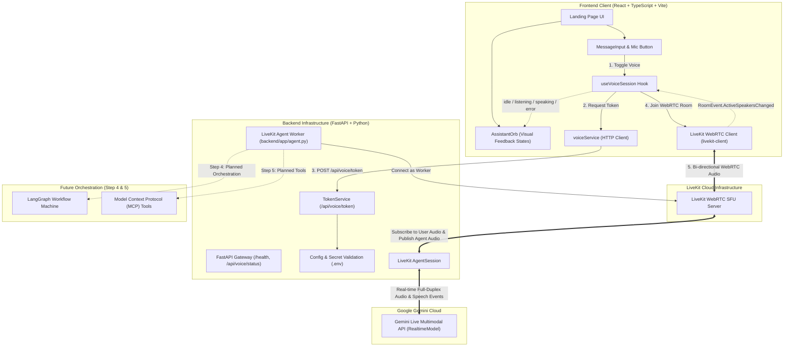

# Voxara AI — System Architecture

Voxara AI is a real-time Agentic Voice AI assistant designed for multimodal, responsive voice-first interactions with tool execution and visual status feedback.

---

## High-Level Architecture (Current: Step 3 — Gemini Live Integration)



---

## Data Flow: Voice Conversation Pipeline

1. **User Speaks**:
   - The user clicks the microphone button and speaks into their device.
   - The browser's WebRTC audio track is published to the LiveKit room.
2. **Audio Transport**:
   - LiveKit WebRTC SFU routes the raw audio packets to the connected Python `AgentSession` worker process.
3. **Gemini Live Multimodal Processing**:
   - `livekit-plugins-google` streams the audio packets to Google's Gemini Live API via WebSocket using the configured model (`gemini-2.5-flash-native-audio-preview-12-2025` or `gemini-2.0-flash-exp`).
   - Gemini Live detects speech boundaries, transcribes intent, and generates native spoken audio.
4. **Agent Response**:
   - The incoming audio stream from Gemini Live is packaged into audio frames and published to the LiveKit room.
5. **Playback & Visual State**:
   - The browser client receives the agent's audio track and plays it through HTMLAudioElement.
   - `RoomEvent.ActiveSpeakersChanged` flags the agent participant as active speaker, transitioning `AssistantOrb` into the resonant `speaking` wave. When the user speaks, it shifts to `listening`.

---

## Directory Structure

```
voxara-ai/
├── docs/
│   ├── ARCHITECTURE.md          # System architecture and directory documentation
│   └── DEVELOPMENT_PLAN.md      # Phased development roadmap
├── backend/
│   ├── app/
│   │   ├── routes/
│   │   │   ├── __init__.py
│   │   │   └── voice.py         # /api/voice/token & /api/voice/status endpoints
│   │   ├── services/
│   │   │   ├── __init__.py
│   │   │   └── token_service.py # LiveKit JWT AccessToken generation
│   │   ├── __init__.py
│   │   ├── agent.py             # LiveKit Voice Agent worker with Gemini Live RealtimeModel
│   │   ├── config.py            # Pydantic Settings & environment variable validation
│   │   └── main.py              # FastAPI app setup, CORS, lifespan, and /health
│   ├── .env.example             # Template for required environment variables
│   ├── requirements.txt         # FastAPI, LiveKit SDK, Agent & Google plugin dependencies
│   ├── venv/                    # Python virtual environment
│   └── README.md                # Backend service documentation
├── frontend/
│   ├── public/                  # Static assets
│   ├── src/
│   │   ├── app/
│   │   │   └── LandingPage.tsx  # Main application view with voice controls & live state
│   │   ├── components/
│   │   │   ├── assistant/
│   │   │   │   ├── AssistantOrb.tsx   # Animated visual state orb
│   │   │   │   ├── MessageInput.tsx   # Input bar & mic button
│   │   │   │   └── StateSelector.tsx  # Dev preview state selector
│   │   │   └── layout/
│   │   │       ├── Header.tsx         # Header with live state pill
│   │   │       └── Container.tsx      # Responsive container
│   │   ├── hooks/
│   │   │   ├── useAssistantState.ts   # State management hook
│   │   │   └── useVoiceSession.ts     # LiveKit WebRTC session hook (with agentJoined tracking)
│   │   ├── lib/
│   │   │   └── voiceService.ts        # API client for backend voice endpoints
│   │   ├── types/
│   │   │   └── assistant.ts           # State, session, and error interfaces
│   │   ├── index.css                  # Global CSS & Tailwind directives
│   │   └── main.tsx                   # React root entrypoint
│   ├── index.html
│   ├── package.json
│   ├── tailwind.config.js
│   ├── tsconfig.json
│   └── vite.config.ts
├── .gitignore                   # Root gitignore (env files, node_modules, venv, bytecode)
└── README.md                    # Project overview & startup instructions
```

---

## Voice Session State Machine

| Assistant State | Trigger / Source | Visual Representation |
| :--- | :--- | :--- |
| `idle` | Connected room with no active speakers, or standby. | Ambient warm golden breathing pulse. |
| `connecting` | Fetching token and negotiating WebRTC peer connection. | Radiant swirling transition. |
| `listening` | WebRTC participant's local audio track is unmuted and active. | Expanded radiant yellow wave. |
| `speaking` | Remote Voxara agent is actively transmitting Gemini voice. | Vocal resonance modulation. |
| `thinking` | Initializing session / negotiating connection. | Swirling gradient rotation. |
| `executing` | Agentic workflow / tool execution (future phase). | Rhythmic operational oscillation. |
| `error` | Microphone permission denied, LiveKit, or Gemini error. | Soft coral/crimson indicator with diagnostic alert. |

---

## Security Model

1. **Zero Secret Exposure**: Neither `LIVEKIT_API_SECRET` nor `GOOGLE_API_KEY` are ever passed to the frontend browser client.
2. **Short-Lived Access Tokens**: The backend issues signed JWT tokens with 15-minute time-to-live (`TTL`) granting restricted room access.
3. **Protected Environment**: All credentials remain in `backend/.env` which is strictly ignored by Git.
