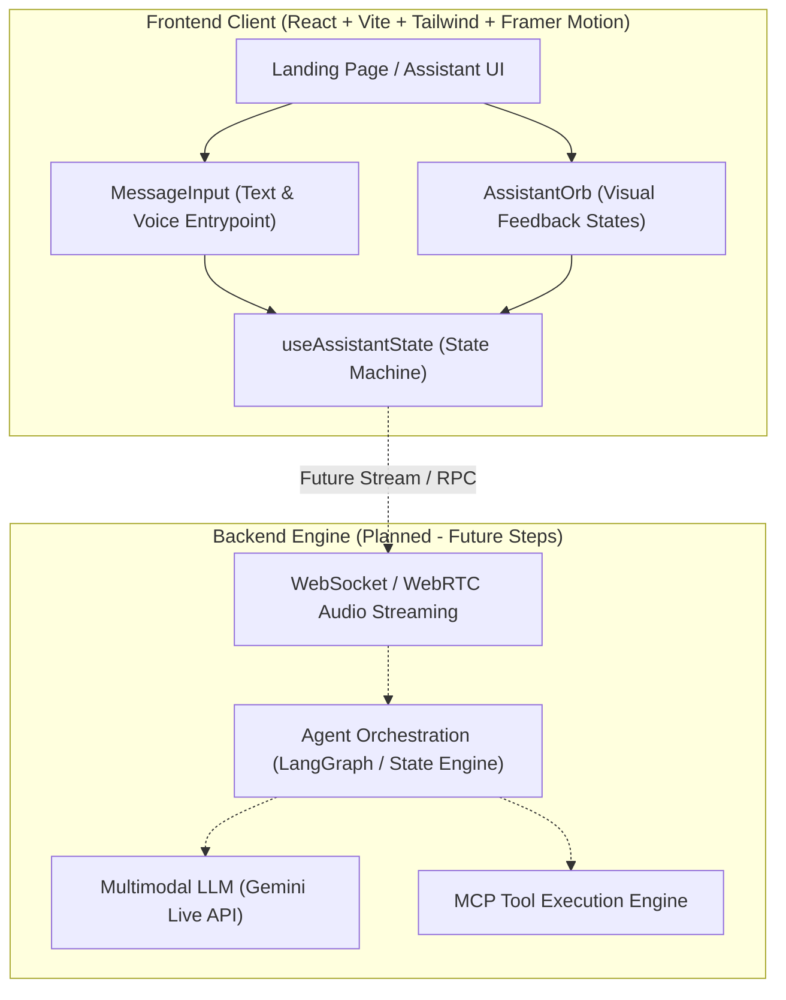

# Voxara AI — System Architecture

Voxara AI is a real-time Agentic Voice AI assistant designed for multimodal, responsive voice-first interactions with tool execution and visual status feedback.

---

## High-Level Architecture (Current & Planned)



---

## Directory Structure (Step 1)

```
voxara-ai/
├── docs/
│   ├── ARCHITECTURE.md          # System architecture and directory documentation
│   └── DEVELOPMENT_PLAN.md      # Phased development roadmap
├── backend/
│   └── README.md                # Placeholder for backend services
├── frontend/
│   ├── public/                  # Static assets
│   ├── src/
│   │   ├── app/                 # Application shell and top-level pages
│   │   ├── components/
│   │   │   ├── assistant/       # Assistant-specific UI (Orb, input, state indicator)
│   │   │   └── layout/          # Layout wrappers, headers, footers
│   │   ├── hooks/               # Custom React hooks (useAssistantState)
│   │   ├── types/               # TypeScript interfaces and union types
│   │   ├── lib/                 # Shared utility functions and style helpers
│   │   ├── index.css            # Global CSS and Tailwind directives
│   │   └── main.tsx             # React entry point
│   ├── index.html               # Vite HTML template
│   ├── package.json             # Frontend package definition
│   ├── tailwind.config.js       # Tailwind CSS configuration
│   ├── postcss.config.js        # PostCSS configuration
│   ├── tsconfig.json            # TypeScript configuration
│   └── vite.config.ts           # Vite configuration
├── .gitignore                   # Root gitignore
└── README.md                    # Project overview & running instructions
```

---

## Major Directory Roles

| Directory | Responsibility |
| :--- | :--- |
| `frontend/src/app/` | Main application views, page compositions, and layout boundaries. |
| `frontend/src/components/assistant/` | Core assistant interaction components: `AssistantOrb` (animated visual state representation), `MessageInput` (accessible text/speech input bar), and `StateSelector` (dev state preview). |
| `frontend/src/components/layout/` | Structural page components (e.g. `Header`, `Container`, `Footer`) ensuring responsive spacing and viewport alignment. |
| `frontend/src/hooks/` | Custom hooks isolating state management, side effects, and lifecycle hooks (`useAssistantState`). |
| `frontend/src/types/` | Strict TypeScript domain models, state union types, and interface contracts. |
| `frontend/src/lib/` | Pure utility functions, class name mergers, and animation constants. |
| `backend/` | Target location for FastAPI services, voice WebSocket connections, and agent tool execution. |
| `docs/` | Architectural specifications, design rationales, and phase-by-phase planning. |
